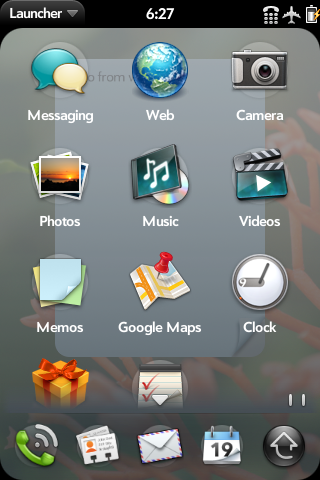

# Palm webOS in the browser

Genuine webOS 1.4.5 SDK running locally in WebAssembly with v86.

**[Launch webOS in your browser](https://sookcha.github.io/palm-pre/)**

## Demo

[](media/webos-demo.mp4)

[Watch the 19-second demo (MP4)](media/webos-demo.mp4): typing in Memos, switching to card view, and scrolling the launcher. Recorded directly from the running emulator, without audio.

## Run locally

Supply the SDK disk and kernel in `public/images/`; [sources.json](sources.json) records their provenance and extraction commands.

```sh
npm ci
npm run dev
```

Open the local URL and select **Boot webOS**. Startup can take several minutes. Click or tap to interact, and drag to scroll; input supports one pointer at a time. Guest changes are lost when the page closes.

## Hosting

GitHub Actions tests and deploys `main` to GitHub Pages. It downloads the archived SDK, converts the disk, and includes it in the static deployment; the guest image is not committed to Git. The full disk is about 800 MB, but the emulator loads disk ranges on demand. The webOS guest remains proprietary; its inclusion does not grant redistribution rights.
